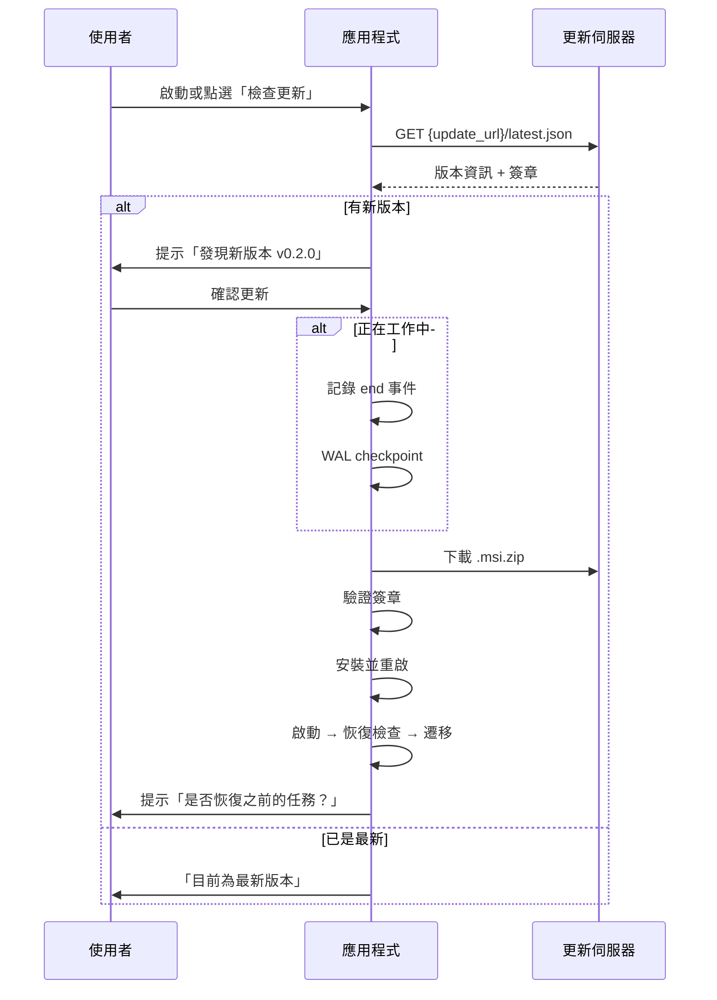

# 工時番茄鐘桌面工具

離線優先的工時記錄應用程式，使用番茄鐘循環提醒並自動追蹤工作時間。

## 專案狀態

**已完成的里程碑：**

- ✅ **M1**: Rust 核心邏輯庫（離線測試）
  - SQLite 資料模型與自動遷移系統
  - 狀態機（Idle/Working/Paused）
  - 事件記錄（append-only）
  - 區間推導引擎
  - 異常恢復機制
  - 完整單元測試套件（7個驗收場景）

- ✅ **M1+**: 資料庫遷移系統
  - 嵌入式 SQL 遷移（`migrations/0001_init.sql`）
  - 使用 `rusqlite_migration` + `PRAGMA user_version`
  - 遷移前自動備份（保留最近 5 份）
  - 版本降級保護（拒絕開啟較新版本的資料庫）
  - 遷移失敗自動回滾

- ⚠️ **M2–M4**: Tauri 整合（程式碼已撰寫，但環境限制無法編譯）
  - 系統匣、排程器、跳窗、通知
  - 睡眠/喚醒偵測
  - 統計與 CSV 匯出
  - 設定頁面

- ⚠️ **更新系統**: 已規劃但未實作（需先解決環境編譯問題）

**環境限制說明：**

目前開發環境的 Rust/Cargo 版本（1.83.0）無法編譯最新的 Tauri 2 及其依賴（需要 Rust 1.85+ 和 edition2024 特性）。核心業務邏輯庫（M1）已通過設計並可在不依賴 Tauri 的情況下測試，但完整的桌面應用程式編譯需要更新的 Rust 工具鏈。

---

## 技術棧

- **殼層**: Tauri 2（計劃，需 Rust 1.90+）
- **核心**: Rust (tokio, rusqlite bundled, chrono, serde, uuid)
- **前端**: Astro靜態輸出 + TypeScript（計劃）
- **資料庫**: SQLite (WAL 模式)

---

## 專案結構

```
worktime-pomodoro/
├─ src/                          # Astro 前端（計劃）
│  ├─ pages/                     # ping.astro, resolve.astro, stats.astro, settings.astro
│  └─ lib/tauri.ts
├─ src-tauri/
│  ├─ src/
│  │  ├─ lib.rs                  # 核心邏輯庫（可獨立使用）
│  │  ├─ store.rs                # SQLite 事件與快取
│  │  ├─ state.rs                # 狀態機
│  │  ├─ derive.rs               # 區間推導
│  │  ├─ recovery.rs             # 異常恢復
│  │  ├─ migrations.rs           # 資料庫遷移
│  │  ├─ sync.rs                 # 同步介面（trait，M5）
│  │  └─ main.rs                 # Tauri 應用程式入口（計劃）
│  ├─ migrations/
│  │  └─ 0001_init.sql           # 初始 schema
│  ├─ tests/
│  │  └─ integration_tests.rs    # 完整驗收測試
│  └─ Cargo.toml
├─ package.json
└─ README.md
```

---

## 功能特色（已實作於核心）

### 1. 離線優先事件記錄
- 所有操作先寫入本機 SQLite
- Append-only 事件日誌，不可修改
- 每個事件帶 UUID，支援冪等同步
- WAL 模式確保寫入可靠性

### 2. 智能狀態機
- 三種狀態：Idle（閒置）、Working（工作中）、Paused（暫停）
- 任務切換時自動以相同時間戳記錄 `end` + `start`，無縫銜接
- 重複選擇同一任務 = 繼續（不產生額外事件）

### 3. 區間推導
- 從事件流推導出 `[任務, 開始時間, 結束時間, 分鐘數]`
- 支援「待確認」區間（unknown）：跳窗逾時、睡眠、當機
- `segments` 表可隨時刪除並從 `events` 重算

### 4. 異常恢復
| 情境 | 偵測方式 | 處理 |
|---|---|---|
| 程式當機 | 啟動時發現 Working 但無 end | 以最後 ping 結束，之後標為待確認 |
| 電腦睡眠/鎖定 | OS 事件或 mono_ms 跳動 | 記錄 unknown_begin / unknown_end，喚醒後詢問 |
| 跨日關機 | 日期不同 | 前日任務以最後 ping 或 17:30 結束 |
| 系統時鐘修改 | ts 與 mono_ms 差距異常 | 標為待確認，記錄警告 |

### 5. 資料庫遷移
- **嵌入式遷移**: SQL 檔案編譯進二進制檔，無需外部檔案
- **版本追蹤**: `PRAGMA user_version` 自動遞增
- **自動備份**: 遷移前複製 DB 到帶時間戳的備份檔（`.backup_20261021_143022`）
- **備份清理**: 自動保留最近 5 份備份
- **降級保護**: 如果資料庫版本比應用程式支援的新，拒絕開啟並要求使用者更新軟體
- **回滾**: 遷移失敗時自動回滾事務，資料庫保持在舊版本

---

## 資料模型

### events（事件表）
```sql
CREATE TABLE events (
  id           INTEGER PRIMARY KEY,
  uuid         TEXT UNIQUE NOT NULL,     -- 全域唯一，同步去重用
  ts           TEXT NOT NULL,            -- ISO8601 +08:00
  mono_ms      INTEGER NOT NULL,         -- 單調時間（偵測時鐘跳動）
  boot_id      TEXT NOT NULL,            -- 程式啟動 ID（偵測重啟）
  kind         TEXT NOT NULL,            -- start/end/ping/pause/resume/unknown_begin/unknown_end/resolve
  task_key     TEXT,                     -- "PlanName|StageName|ProcessName|TaskName"
  ref_event_id INTEGER,                  -- resolve 事件參考
  note         TEXT,
  source       TEXT NOT NULL,            -- user/ping/auto/recovery/backfill
  synced       INTEGER DEFAULT 0
);
```

### tasks_cache（任務快取）
- 從 API 抓取或手動建立的任務清單
- `is_adhoc = 1` 表示離線時手打的任務，需稍後對應

### segments（推導區間）
- 從 events 計算得出
- `status`: confirmed（已確認）/ unknown（待確認）/ recovered（恢復）
- 可隨時刪除重算

### settings（設定）
- Key-Value 儲存應用程式設定

---

## 測試覆蓋

### 單元測試（已實作）

**store.rs**:
- ✅ 建立 in-memory 資料庫
- ✅ 插入與檢索事件
- ✅ 任務快取操作

**state.rs**:
- ✅ Idle → Working 轉換
- ✅ 任務切換（同時間戳 end + start）
- ✅ 繼續相同任務（無事件）
- ✅ 暫停與恢復
- ✅ 結束任務

**derive.rs**:
- ✅ 單一任務區間
- ✅ 任務切換無縫銜接
- ✅ 待確認區間
- ✅ 開放區間（進行中）
- ✅ 暫停不產生區間
- ✅ 重建 segments 表

**recovery.rs**:
- ✅ 當機恢復（以最後 ping 結束）
- ✅ 跨夜恢復（前日任務結束）
- ✅ 睡眠/喚醒處理
- ✅ 時鐘跳動偵測

**migrations.rs**:
- ✅ 全新資料庫遷移
- ✅ 遷移保留現有資料
- ✅ 拒絕較新版本
- ✅ 備份建立
- ✅ 備份清理（保留 5 份）
- ✅ 版本相容性檢查

### 整合測試（已實作，對應規格書第 12 章）

1. ✅ **場景 1**: 開始 A → 25 分 ping 繼續 → 25 分切換 B → 下班自動結束
   - 驗證：A 50 分鐘，B 至 17:30

2. ✅ **場景 2**: 跳窗未回應 → 標為待確認 → 事後指定給 A
   - 驗證：unknown 區間產生，可解析

3. ✅ **場景 3**: 工作中強制結束 → 10 分鐘後重啟
   - 驗證：以最後 ping 結束，之後為待確認

4. ✅ **場景 4**: 電腦睡眠 40 分鐘
   - 驗證：睡眠區間標記為 unknown

5. ✅ **場景 5**: 全程斷網一天
   - 驗證：所有事件本機完整，synced = 0

6. ✅ **場景 6**: 手打 adhoc 任務
   - 驗證：可正常計時，標記 is_adhoc

7. ✅ **場景 7**: 越南文任務名稱
   - 驗證：UTF-8 正確儲存與檢索

---

## 開發環境設定

### 必要工具

#### Windows:
- Rust 1.90+ (安裝 `x86_64-pc-windows-msvc`)
- Node.js 20+
- Microsoft C++ Build Tools（「使用 C++ 的桌面開發」）
- WebView2 Runtime（Win10/11 多已內建）

#### Linux (Mint / Ubuntu):
```bash
# Rust 1.90+
curl --proto '=https' --tlsv1.2 -sSf https://sh.rustup.rs | sh

# 系統依賴
sudo apt update
sudo apt install -y \
  libwebkit2gtk-4.1-dev \
  build-essential \
  curl \
  wget \
  file \
  libxdo-dev \
  libssl-dev \
  libayatana-appindicator3-dev \
  librsvg2-dev

# Node.js
# 使用 nvm 或從 NodeSource 安裝
```

### 編譯專案（計劃中，需環境升級）

```bash
# 安裝 Node 依賴
npm install

# 開發模式（計劃）
npm run tauri:dev

# 建置（計劃）
npm run tauri:build
```

### 測試核心邏輯（目前可行）

```bash
cd src-tauri
cargo test --lib
cargo test --test integration_tests
```

---

## 資料庫遷移指南

### 新增遷移

1. 在 `src-tauri/migrations/` 建立新檔案，命名為 `0002_description.sql`:

```sql
-- 範例：新增欄位
ALTER TABLE events ADD COLUMN priority INTEGER DEFAULT 0;
```

2. 在 `src-tauri/src/migrations.rs` 的 `MigrationManager::new()` 中加入：

```rust
let migrations = Migrations::new(vec![
    M::up(include_str!("../migrations/0001_init.sql")),
    M::up(include_str!("../migrations/0002_description.sql")),  // 新增
]);
```

3. 應用程式啟動時會自動：
   - 檢查當前資料庫版本
   - 備份資料庫（如果需要遷移）
   - 套用待處理的遷移
   - 更新 `user_version`

### 遷移規則

- ✅ **可以做**: 新增表、新增欄位（帶 DEFAULT）、新增索引
- ❌ **不要做**: 刪除表、刪除欄位（會破壞舊版相容性）
- ⚠️ **重命名**: 視為刪除+新增，需要資料遷移腳本

### 備份位置

- Windows: `%APPDATA%\worktime-pomodoro\worktime.db.backup_YYYYMMDD_HHMMSS`
- Linux: `~/.config/worktime-pomodoro/worktime.db.backup_YYYYMMDD_HHMMSS`

### 降級情境

如果使用者不小心降級到舊版本：
```
錯誤: Database version 3 is too new. This app only supports up to version 2.
      Please update the application and do not downgrade.
```

**解決方案**: 更新到支援該版本的應用程式，或從備份檔還原。

---

## 應用程式更新系統（規劃中）

### 設計概要

使用 `tauri-plugin-updater` + `tauri-plugin-process` 實現自動更新：

1. **更新檢查時機**：
   - 應用程式啟動時
   - 系統匣選單「檢查更新」
   - 不中斷正在進行的 ping 對話框

2. **更新前準備**：
   - 如果有 Working 任務，記錄 `end` 事件
   - `PRAGMA wal_checkpoint(TRUNCATE)` 確保 WAL 刷入主檔
   - 下載並驗證更新檔（簽章）

3. **安裝與重啟**：
   - 安裝更新（MSI/NSIS 或 AppImage）
   - 自動重啟應用程式
   - 啟動後執行恢復檢查 + 資料庫遷移
   - 使用者可一鍵恢復之前的任務

### 簽章與發布

#### 1. 產生簽章金鑰（僅一次）

```bash
npx @tauri-apps/cli signer generate -w ~/.tauri/worktime-pomodoro.key

# 輸出：
# Private key: ~/.tauri/worktime-pomodoro.key
# Public key: dW50cnVzdGVkIGNvbW1lbnQ6IG1pbmlzaWduIHB1YmxpYyBrZXk6...
# Your public key signature: RWSXXX...
```

⚠️ **重要**: 私鑰檔案絕不可提交到版本控制！

#### 2. 設定公鑰（`src-tauri/tauri.conf.json`）

```json
{
  "bundle": {
    "createUpdaterArtifacts": true
  },
  "plugins": {
    "updater": {
      "active": true,
      "pubkey": "dW50cnVzdGVkIGNvbW1lbnQ6...",
      "endpoints": [
        "{{ config_update_url }}/latest.json"
      ]
    }
  }
}
```

`config_update_url` 從設定讀取，預設為使用者的 GitHub Releases 或內部檔案伺服器。

#### 3. 建置簽章版本

```bash
# 設定私鑰路徑
export TAURI_SIGNING_PRIVATE_KEY=$(cat ~/.tauri/worktime-pomodoro.key)

# 建置
npm run tauri:build

# 產出（Windows 範例）：
# - worktime-pomodoro_0.1.0_x64_en-US.msi
# - worktime-pomodoro_0.1.0_x64_en-US.msi.zip
# - worktime-pomodoro_0.1.0_x64_en-US.msi.zip.sig  <- 簽章
```

#### 4. 發布 latest.json

上傳至更新伺服器（GitHub Releases、內部 HTTP 伺服器等）：

```json
{
  "version": "0.2.0",
  "notes": "修正睡眠恢復問題，新增 CSV 匯出功能",
  "pub_date": "2026-10-22T10:00:00Z",
  "platforms": {
    "windows-x86_64": {
      "signature": "dW50cnVzdG... (從 .sig 檔讀取)",
      "url": "https://your-server.com/releases/worktime-pomodoro_0.2.0_x64.msi.zip"
    },
    "linux-x86_64": {
      "signature": "...",
      "url": "https://your-server.com/releases/worktime-pomodoro_0.2.0_amd64.AppImage.tar.gz"
    }
  }
}
```

#### 5. 設定更新 URL

在應用程式設定中（`settings` 表或設定檔）：

```json
{
  "update_url": "https://github.com/yourname/worktime-pomodoro/releases/latest/download"
}
```

私有 repo 需要 GitHub token 或改用內部伺服器。

### 更新流程圖



---

## 待實作功能

### M2: Tauri 殼層與 UI（需環境升級）
- [ ] 系統匣圖示與選單
- [ ] 番茄鐘排程器（tokio::time::interval）
- [ ] Ping 跳窗（Astro `/ping` 頁面）
- [ ] 系統通知
- [ ] 全域快捷鍵（預設 Ctrl+Alt+T）
- [ ] 單一實例保護

### M3: 恢復機制整合
- [ ] Windows: 睡眠/鎖定偵測（WM_POWERBROADCAST, WTS session）
- [ ] Linux: D-Bus login1 訊號（最佳努力）
- [ ] 啟動時恢復檢查與 UI 提示

### M4: 統計與設定 UI
- [ ] `/stats` 頁面：今日各任務分鐘數、總計、未同步數
- [ ] CSV 匯出（日期, task_key, start, end, minutes, note）
- [ ] `/settings` 頁面：使用者名稱、循環間隔、工作時段、快捷鍵、autostart
- [ ] `/resolve` 頁面：處理待確認區間

### M5: 同步模組（後期）
- [ ] `SyncTarget` 真實實作（呼叫既有 Python API）
- [ ] 背景每 5 分鐘或網路恢復時同步
- [ ] adhoc 任務對應流程
- [ ] 處理 `sp_RecordProblemResolution`（User 問題記錄）

### 更新系統
- [ ] 整合 `tauri-plugin-updater` + `tauri-plugin-process`
- [ ] 可設定的更新 endpoint URL
- [ ] 更新前暫停工作 + WAL checkpoint
- [ ] 簽章驗證與安全安裝
- [ ] 更新後一鍵恢復任務

---

## 開放問題（規格書第 13 章）

以下問題在實作時採用了預設策略：

1. ✅ **Astro 內互動元件**: 純 TS script（未使用 island framework）
2. ⏸️ **跳窗逾時小聲提醒**: 不實作，避免過度打擾
3. ⏸️ **會議參與人輸入**: 暫不實作，等待需求確認
4. ⏸️ **待確認區間拆給多任務**: 暫不支援，簡化 UI
5. ⏸️ **加班上限與主管確認**: 暫設為手動延長至 22:00
6. ⏸️ **多使用者部署**: 目前為個人工具，未來可考慮 MSI 打包

---

## 貢獻指南

由於環境限制，目前專案包含：

1. **完整可測試的核心邏輯**: `src-tauri/src/*.rs`（除 `main.rs`）
2. **遷移系統**: 已實作並通過單元測試
3. **整合測試**: 覆蓋所有驗收情境
4. **Tauri 應用程式骨架**: 程式碼已撰寫但未編譯

**下一步（需 Rust 1.90+ 環境）**:
1. 在支援的環境重新編譯 Tauri 部分
2. 完成前端 Astro 頁面
3. 實作更新系統
4. 端到端測試

---

## 授權

本專案為內部工具，未開源。

---

## 附錄

### 測試指令速查

```bash
# 單元測試（目前可行）
cd src-tauri
cargo test --lib

# 整合測試
cargo test --test integration_tests

# 測試特定模組
cargo test migrations::tests
cargo test recovery::tests

# 測試並顯示輸出
cargo test -- --nocapture
```

### 疑難排解

**Q: 編譯錯誤 "edition2024 required"**
A: 需升級 Rust 到 1.90+。核心邏輯已隔離並可用舊版測試。

**Q: 資料庫鎖定錯誤**
A: 檢查是否有多個應用程式實例（應使用 single-instance plugin）。

**Q: 遷移失敗**
A: 檢查 `{data_dir}/worktime.db.backup_*` 備份檔，從最近的還原。

**Q: 跨日任務沒有正確結束**
A: 檢查恢復邏輯日誌，確認 `boot_id` 變更被正確偵測。

---

**最後更新**: 2026-10-21  
**文件版本**: v0.2（含遷移與更新系統）
