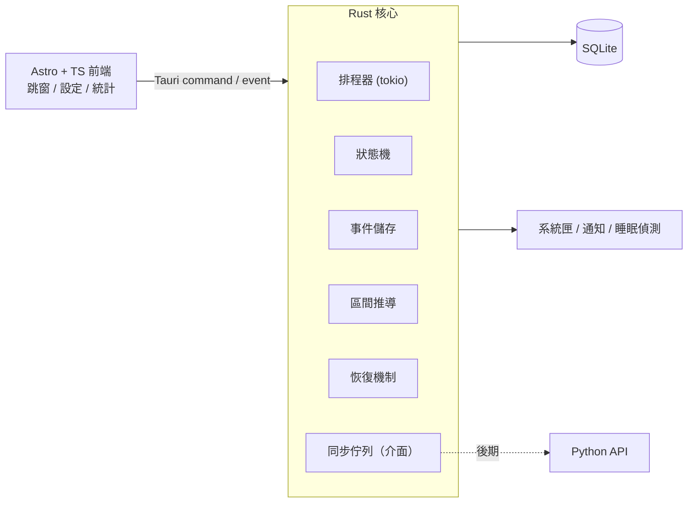
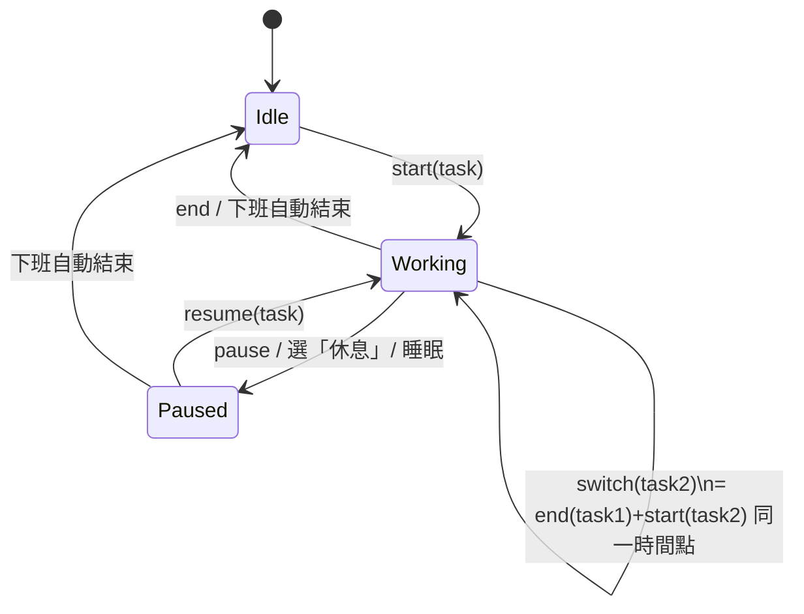

# 工時番茄鐘桌面工具 規格書 v0.2

| 項目 | 內容 |
|---|---|
| 文件版本 | v0.2（草案：前端改 Astro、新增環境依賴） |
| 日期 | 2026-10-21 |
| 作者 | 林俊宇 |
| 狀態 | 待討論 |

---

## 1. 背景與目標

### 1.1 問題
- 公司要求以「分鐘」為單位記錄工時，目前必須手動在 SSMS 執行 `EXEC Plan3TaskNameStart / Plan3TaskNameEnd`。
- 工作中常切換任務、處理臨時問題，**容易忘記記錄開始／結束**，事後補填不準確。
- 網路／內網環境不穩時，無法即時寫入 MES DB，紀錄會遺失。

### 1.2 目標
1. 以**番茄鐘循環**定時跳窗，強制確認「現在在做哪個任務」，把記錄成本降到「點一下」。
2. **離線優先（Offline-first）**：所有工時先寫入本機，網路恢復後再同步，**任何情況不遺失紀錄**。
3. 產出的工時區間能 1:1 對應到現有 SP 的「開始／結束」模型，不改動既有系統。

### 1.3 非目標（v1 不做）
- 不修改 MES 既有 SP 與資料表。
- 不做表一／表二開案、標準工時設定、Clone、滾動等管理功能（仍用 SQL 手冊）。
- **本階段不實作同步 API**（已有 Python API，同步模組留介面，見第 8 章）。
- 不做多人／團隊報表。

---

## 2. 名詞定義

| 名詞 | 說明 |
|---|---|
| 任務（Task） | 對應 Plan3_Task，以 `task_key` 唯一識別 |
| task_key | `PlanName|StageName|ProcessName|TaskName` |
| 事件（Event） | 使用者或系統產生的單一動作紀錄，只新增不修改（append-only） |
| 工時區間（Segment） | 由事件推導出的 `[任務, 開始時間, 結束時間]` |
| Ping | 番茄鐘到點跳窗確認一次 |
| 待確認區間 | 無法確定使用者在做什麼的時間段，需使用者事後指定 |

---

## 3. 技術架構

| 層 | 技術 | 職責 |
|---|---|---|
| 殼層 | **Tauri 2** | 視窗、系統匣、通知、全域快捷鍵、開機自啟 |
| 核心 | **Rust**（tokio、rusqlite、chrono、serde） | 計時排程、狀態機、事件寫入、區間推導、恢復機制、同步佇列 |
| 前端 | **Astro**（靜態輸出 SSG）+ **TypeScript** | 跳窗 UI、任務選擇、設定頁、今日統計；每個視窗對應一個 Astro 頁面 |
| 本機儲存 | **SQLite**（WAL 模式） | 事件、任務快取、設定 |
| 同步（後期） | HTTP → 既有 Python API | 上傳事件／區間 |



**原則**：所有業務邏輯放 Rust；前端只負責顯示與輸入，前端關閉不影響計時。

---

## 3A. 環境依賴

### 3A.1 開發環境

| 類別 | 項目 | 版本／備註 |
|---|---|---|
| Rust | rustup + stable toolchain | Tauri 2 需 Rust ≥ 1.77.2；Windows 用 `x86_64-pc-windows-msvc` |
| Node.js | Node LTS（20 或 22）+ npm／pnpm | Astro 與 Tauri CLI 需要 |
| Tauri CLI | `@tauri-apps/cli` v2（npm devDependency）或 `cargo install tauri-cli --version "^2"` | |
| Windows | Microsoft C++ Build Tools（「使用 C++ 的桌面開發」工作負載） | 編譯 Rust 必要 |
| Windows | **WebView2 Runtime** | Win10/11 多已內建；安裝包可設定自動安裝 |
| Linux（Mint／Ubuntu） | `libwebkit2gtk-4.1-dev build-essential curl wget file libxdo-dev libssl-dev libayatana-appindicator3-dev librsvg2-dev` | 系統匣需 appindicator |
| 工具 | Git、VS Code（rust-analyzer、Astro、Tauri 擴充） | |
| 測試 | `cargo test`、DB Browser for SQLite（人工檢查） | |

> 公司內網若有 Proxy：需設定 `HTTPS_PROXY`（cargo／npm 皆適用）或內部 registry 鏡像，避免重演安裝環境卡網路的狀況。建議 M1 前先在公司電腦驗證能拉 crates.io 與 npm。

### 3A.2 Rust 依賴（`src-tauri/Cargo.toml`）

| Crate | 用途 |
|---|---|
| `tauri` v2（features: `tray-icon`） | 殼層、視窗、系統匣 |
| `tauri-plugin-notification` | 系統通知 |
| `tauri-plugin-global-shortcut` | 全域快捷鍵 |
| `tauri-plugin-autostart` | 開機自啟 |
| `tauri-plugin-single-instance` | 防止重複開啟（避免兩個計時器同時寫入） |
| `tokio`（rt-multi-thread, time, sync） | 番茄鐘排程、背景工作 |
| `rusqlite`（feature: `bundled`） | SQLite，bundled 免另裝 SQLite |
| `chrono` | 時間、時區（+08:00） |
| `serde`、`serde_json` | 前後端資料序列化 |
| `uuid`（v4） | 事件 uuid，同步去重 |
| `thiserror`、`anyhow` | 錯誤處理 |
| `tracing`、`tracing-subscriber`、`tracing-appender` | 本機 log 檔 |
| `windows`（僅 Windows，可選） | 偵測睡眠／鎖定（WM_POWERBROADCAST、WTS session 事件） |
| *(M5)* `reqwest`（rustls） | 呼叫 Python API |
| *(M5)* `keyring` | API 憑證存 OS 憑證管理員 |

### 3A.3 前端依賴（`package.json`）

| 套件 | 用途 |
|---|---|
| `astro` | 前端框架，`output: 'static'` |
| `typescript` | 型別 |
| `@tauri-apps/api` v2 | `invoke` 呼叫 Rust、監聽事件、視窗控制 |
| `@tauri-apps/plugin-notification`、`@tauri-apps/plugin-global-shortcut`、`@tauri-apps/plugin-autostart` | 對應外掛的 JS 端 |
| `@tauri-apps/cli` v2（dev） | 開發與打包 |
| *(可選)* `@astrojs/svelte` 或 `@astrojs/preact` | 跳窗搜尋清單等互動較多的 island |
| *(可選)* Tailwind CSS | 樣式 |

### 3A.4 Astro × Tauri 整合要點
- Astro 必須用**靜態輸出**（不可用 SSR adapter），Tauri 載入 `dist/`。
- `src-tauri/tauri.conf.json`：
  - `build.devUrl` = `http://localhost:4321`（Astro dev server 預設埠）
  - `build.frontendDist` = `../dist`
  - `build.beforeDevCommand` = `npm run dev`；`build.beforeBuildCommand` = `npm run build`
- `astro.config.mjs`：`server: { port: 4321, strictPort: true }`，避免埠號漂移導致 Tauri 連不到。
- 多視窗對應頁面：`/ping`（跳窗）、`/resolve`（待確認）、`/stats`（統計）、`/settings`（設定）；由 Rust 依需要開啟對應 URL 的 WebviewWindow。
- 前端不得直接存取 SQLite，一律經 Tauri command 呼叫 Rust。
- Tauri 2 權限（capabilities）只開放需要的 command 與外掛權限。

### 3A.5 執行環境（使用者電腦）
- Windows 10/11 x64、WebView2 Runtime。
- 不需安裝 Node、Rust、SQLite（皆已打包）。
- 資料位置：`%APPDATA%\<app-id>\worktime.db`、log 於 `%APPDATA%\<app-id>\logs\`。
- 安裝包：Tauri 產出 MSI 或 NSIS（建議 NSIS，可免管理員權限安裝）。

### 3A.6 專案結構（建議）
```
worktime-pomodoro/
├─ src/                    # Astro 前端
│  ├─ pages/ (ping.astro, resolve.astro, stats.astro, settings.astro)
│  ├─ components/
│  └─ lib/tauri.ts         # invoke 包裝與型別
├─ src-tauri/
│  ├─ src/
│  │  ├─ main.rs / lib.rs  # Tauri 啟動、外掛、系統匣
│  │  ├─ scheduler.rs      # 番茄鐘
│  │  ├─ state.rs          # 狀態機
│  │  ├─ store.rs          # SQLite 事件／快取
│  │  ├─ derive.rs         # 區間推導
│  │  ├─ recovery.rs       # 恢復機制
│  │  └─ sync.rs           # SyncTarget trait（M5）
│  ├─ migrations/          # SQL schema
│  ├─ capabilities/
│  └─ tauri.conf.json
├─ astro.config.mjs
└─ package.json
```

---

## 4. 功能需求

### F1 番茄鐘循環與跳窗
- F1.1 可設定循環間隔（預設 25 分鐘，範圍 5–120 分）。
- F1.2 到點時：記錄 `ping` 事件 → 彈出置頂小視窗 → 系統通知。
- F1.3 跳窗預設選中「目前任務」，按 Enter 即「繼續」。
- F1.4 跳窗 **N 分鐘未回應**（預設 5 分）自動收起，該段標記為「待確認」，不自動猜測。
- F1.5 可「延後 5 分鐘」（snooze），最多連續 2 次。
- F1.6 工作時段外（預設 08:00–17:30，可設定）不跳窗。

### F2 任務選擇
- F2.1 清單來源：本機任務快取 + 最近使用（最多 10 筆）。
- F2.2 支援關鍵字搜尋（PlanName / TaskName 模糊比對）。
- F2.3 可**臨時手打任務**（離線無清單時），標記 `is_adhoc = 1`，同步時再對應。
- F2.4 內建特殊選項：「會議」、「處理 User 問題」、「休息／離開」。
  - 「處理 User 問題」需輸入：廠區（TW/DG/VN/ZJ）、反映人、問題描述（對應 `sp_RecordProblemResolution`）。
- F2.5 可附註 note（選填）。

### F3 狀態機
狀態：`Idle`（閒置）、`Working(task)`（工作中）、`Paused`（暫停／離開）



- F3.1 同一時間只能有 **一個** Working 任務。
- F3.2 切換任務時，`end` 與 `start` 使用**相同時間戳**，確保無空洞、無重疊。
- F3.3 選同一任務 = 繼續，不產生新事件（只有 ping）。

### F4 手動操作
- F4.1 系統匣選單：開始／切換、暫停、結束目前任務、開啟統計、設定、離開。
- F4.2 全域快捷鍵（預設 `Ctrl+Alt+T`）立即開啟任務選擇。
- F4.3 **補填**：可指定「從 X 分鐘前開始」或「X 分鐘前結束」（對應 SP 的 `@ExecBackfillStartMinTime / @ExecBackfillEndMinTime`）。

### F5 待確認區間處理
- F5.1 以下情況產生待確認區間：跳窗未回應、睡眠／鎖定、程式異常中斷。
- F5.2 下次互動時提示：「09:40–10:20 你在做什麼？」選項：歸給某任務／會議／休息／忽略。
- F5.3 下班前若仍有未處理的待確認區間，主動提醒一次。

### F6 自動結束
- F6.1 到達下班時間（預設 17:30）自動對 Working 任務記 `end`。
- F6.2 若要加班，可按「延長工作」繼續（延至手動結束或 22:00 上限）。

### F7 今日統計
- F7.1 顯示今日各任務累計分鐘數、總工時、待確認分鐘數、未同步筆數。
- F7.2 可匯出 CSV（日期、task_key、開始、結束、分鐘、note）。

### F8 設定
- 使用者名稱（對應 TaskUser）、循環間隔、跳窗逾時、工作時段、下班時間、快捷鍵、開機自啟、同步 API 位址（預留）。

---

## 5. 資料模型（SQLite）

```sql
-- 事件：只新增，不修改、不刪除
CREATE TABLE events (
  id           INTEGER PRIMARY KEY AUTOINCREMENT,
  uuid         TEXT NOT NULL UNIQUE,    -- 同步去重用
  ts           TEXT NOT NULL,           -- ISO8601 含時區 (+08:00)
  mono_ms      INTEGER NOT NULL,        -- 程式啟動後單調時間，用於偵測時鐘跳動
  boot_id      TEXT NOT NULL,           -- 每次程式啟動產生一個
  kind         TEXT NOT NULL,           -- start/end/ping/pause/resume/unknown_begin/unknown_end/resolve
  task_key     TEXT,
  ref_event_id INTEGER,                 -- resolve 事件指向被處理的待確認區間
  note         TEXT,
  source       TEXT NOT NULL,           -- user/ping/auto/recovery/backfill
  synced       INTEGER NOT NULL DEFAULT 0,
  created_at   TEXT NOT NULL DEFAULT (datetime('now','localtime'))
);
CREATE INDEX ix_events_ts ON events(ts);
CREATE INDEX ix_events_synced ON events(synced);

-- 任務快取（從 API 撈或手動建立）
CREATE TABLE tasks_cache (
  task_key     TEXT PRIMARY KEY,
  plan_name    TEXT, stage_name TEXT, process_name TEXT, task_name TEXT,
  task_id      INTEGER,                 -- MES TaskId（可能為空）
  is_adhoc     INTEGER NOT NULL DEFAULT 0,
  is_closed    INTEGER NOT NULL DEFAULT 0,
  last_used_at TEXT,
  fetched_at   TEXT
);

-- 推導結果（可隨時刪除重算）
CREATE TABLE segments (
  id           INTEGER PRIMARY KEY,
  task_key     TEXT,                    -- NULL = 待確認
  start_ts     TEXT NOT NULL,
  end_ts       TEXT,                    -- NULL = 進行中
  minutes      INTEGER,
  status       TEXT NOT NULL,           -- confirmed/unknown/recovered
  synced       INTEGER NOT NULL DEFAULT 0
);

CREATE TABLE settings ( key TEXT PRIMARY KEY, value TEXT NOT NULL );
```

**規則**
- `events` 是唯一真實來源（source of truth）；`segments` 永遠可由 events 重算。
- 修正錯誤一律「新增修正事件」，不改舊資料，保留稽核軌跡。
- SQLite 開 `PRAGMA journal_mode=WAL; PRAGMA synchronous=NORMAL;`，每個事件單獨 commit。

---

## 6. 區間推導規則

1. 依 `ts` 排序事件，逐筆套用狀態機。
2. `start(A)` 開啟 A 的區間；`end(A)` / `switch` / `pause` 關閉。
3. `unknown_begin` ~ `unknown_end` 產生 `status = unknown` 區間；`resolve` 事件可將其改歸某任務。
4. 分鐘數：`floor((end - start) / 60s)`，不足 1 分鐘的區間保留但標示。
5. 驗證：同一時間不得有兩個 confirmed 區間重疊；若發生，以較晚事件為準並記錄警告。

---

## 7. 離線與異常恢復

| 情境 | 偵測方式 | 處理 |
|---|---|---|
| 程式當機／強制關閉 | 啟動時發現最後狀態為 Working 但無 `end` | 以**最後一筆 ping 時間**為結束（source=recovery），之後到現在標為待確認，並詢問使用者 |
| 電腦睡眠／鎖定 | OS 電源／鎖定事件；或 mono_ms 與 ts 差距異常 | 睡眠開始記 `unknown_begin`，喚醒記 `unknown_end`，喚醒後詢問 |
| 關機過夜 | 啟動時日期已變 | 前一日 Working 任務以前一日最後 ping 或下班時間結束 |
| 系統時間被修改 | `ts` 差值與 `mono_ms` 差值不符 > 2 分鐘 | 記警告，該段標為待確認 |
| 磁碟／DB 寫入失敗 | rusqlite 錯誤 | 重試 3 次；仍失敗則寫入備援 JSONL 檔並通知使用者 |
| 無任務清單（首次離線） | tasks_cache 為空 | 允許手打任務（is_adhoc） |

**保證**：任何時刻最多只會遺失「最後一次 ping 到當機之間」的時間，且該段會被標為待確認，不會被默默算錯。

---

## 8. 同步介面（預留，本階段不實作）

- Rust 定義 trait，之後接既有 Python API：
```rust
trait SyncTarget {
    async fn fetch_tasks(&self, user: &str) -> Result<Vec<Task>>;
    async fn push_events(&self, events: &[Event]) -> Result<Vec<Uuid>>; // 回傳成功的 uuid
}
```
- 背景每 5 分鐘（或網路恢復時）取 `synced = 0` 事件批次上傳，成功者標記 `synced = 1`。
- 以 `uuid` 去重，重送安全（冪等）。
- 由 Python API 端負責轉換為 `Plan3TaskNameStart/End` + Backfill 參數、`sp_RecordProblemResolution`。
- adhoc 任務同步前需對應到正式 task_key，否則保留在待處理清單。

---

## 9. 非功能需求

| 項目 | 指標 |
|---|---|
| 資源 | 常駐記憶體 < 80 MB；閒置 CPU ≈ 0% |
| 安裝包 | < 15 MB |
| 啟動 | < 2 秒進系統匣 |
| 跳窗反應 | 到點後 < 1 秒顯示 |
| 可靠性 | 事件寫入成功後即持久化；當機不損毀 DB |
| 平台 | Windows 10/11（主要），Linux 次要（開發用） |
| 編碼 | 全 UTF-8，支援繁中／簡中／越南文任務名稱 |
| 資安 | 本機 DB 放使用者 AppData；未來 API 憑證存 OS keyring，不寫明碼 |

---

## 10. 畫面清單

1. **跳窗（Ping）**：目前任務（預設選中）、搜尋框、最近任務、特殊選項（會議／User 問題／休息）、note、[繼續] [切換] [延後5分]。
2. **待確認處理窗**：時間段、歸屬選項。
3. **系統匣選單**。
4. **今日統計**：任務分鐘列表、總計、待確認、未同步數、匯出 CSV。
5. **設定頁**。

---

## 11. 開發里程碑

| 階段 | 內容 | 完成標準 |
|---|---|---|
| M0 | 環境建置：依 3A 安裝並在公司電腦驗證可拉 crates.io／npm，`tauri dev` 可開出 Astro 空白頁 | 開發機與公司電腦皆可建置 |
| M1 | Rust 核心 CLI：SQLite 事件表、狀態機、區間推導 | 單元測試覆蓋第 6、7 章所有情境 |
| M2 | Tauri 殼：系統匣、番茄鐘排程、跳窗、通知 | 可連續使用一天且區間正確 |
| M3 | 恢復機制：當機、睡眠、跨日、時鐘跳動 | 手動模擬各情境結果符合第 7 章 |
| M4 | 統計頁、CSV 匯出、設定頁 | 可匯出並人工核對 |
| M5（後期） | 同步：串接 Python API | 斷網一天後同步，MES 工時與本機一致 |

---

## 12. 驗收情境（測試案例）

1. 開始 A → 25 分 ping 選繼續 → 再 25 分切換 B → 下班自動結束：產生 A 50 分、B 至 17:30。
2. 跳窗未回應 → 該段標待確認 → 下次互動歸給 A：A 時數正確增加。
3. 工作中強制結束程式 10 分鐘後重開：A 以最後 ping 結束，其後為待確認並詢問。
4. 電腦睡眠 40 分鐘：喚醒詢問，選「會議」後產生會議區間。
5. 全程斷網一天：所有事件本機完整，未同步數正確。
6. 手打 adhoc 任務：可正常計時，標記待對應。
7. 越南文任務名稱：顯示、儲存、匯出皆無亂碼。

---

## 13. 待決事項

- [x] 前端框架：**Astro**（v0.2 決定）
- [ ] Astro 內互動元件：純 TS script 或搭配 island（Svelte／Preact）？
- [ ] 跳窗逾時後是否要「小聲提醒」再次出現？
- [ ] 會議是否需要輸入參與人（公司定義兩人以上才算會議）？
- [ ] 待確認區間是否允許拆給多個任務？
- [ ] 加班上限與是否需要主管確認？
- [ ] 是否提供給同事使用（影響安裝、設定、更新機制）？
